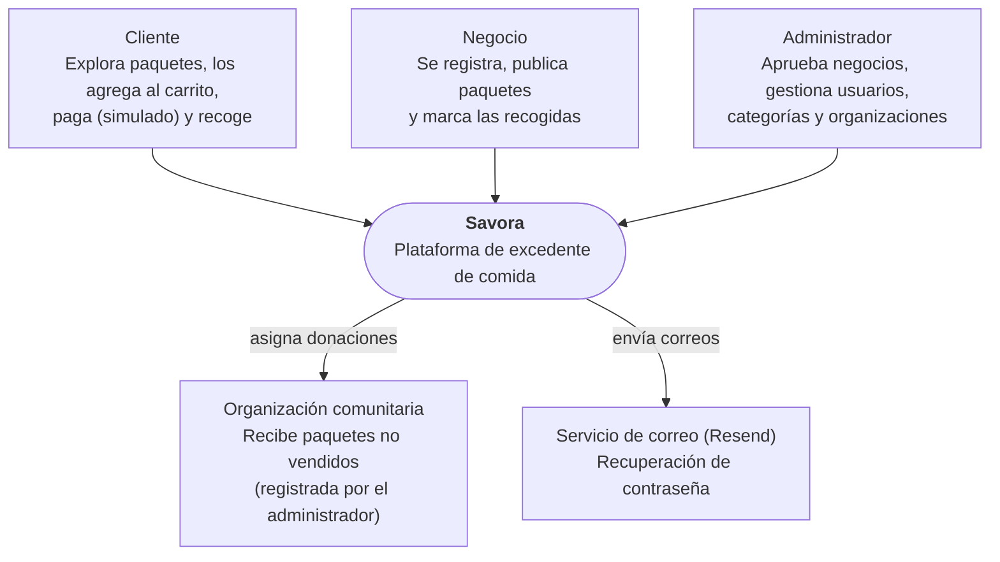
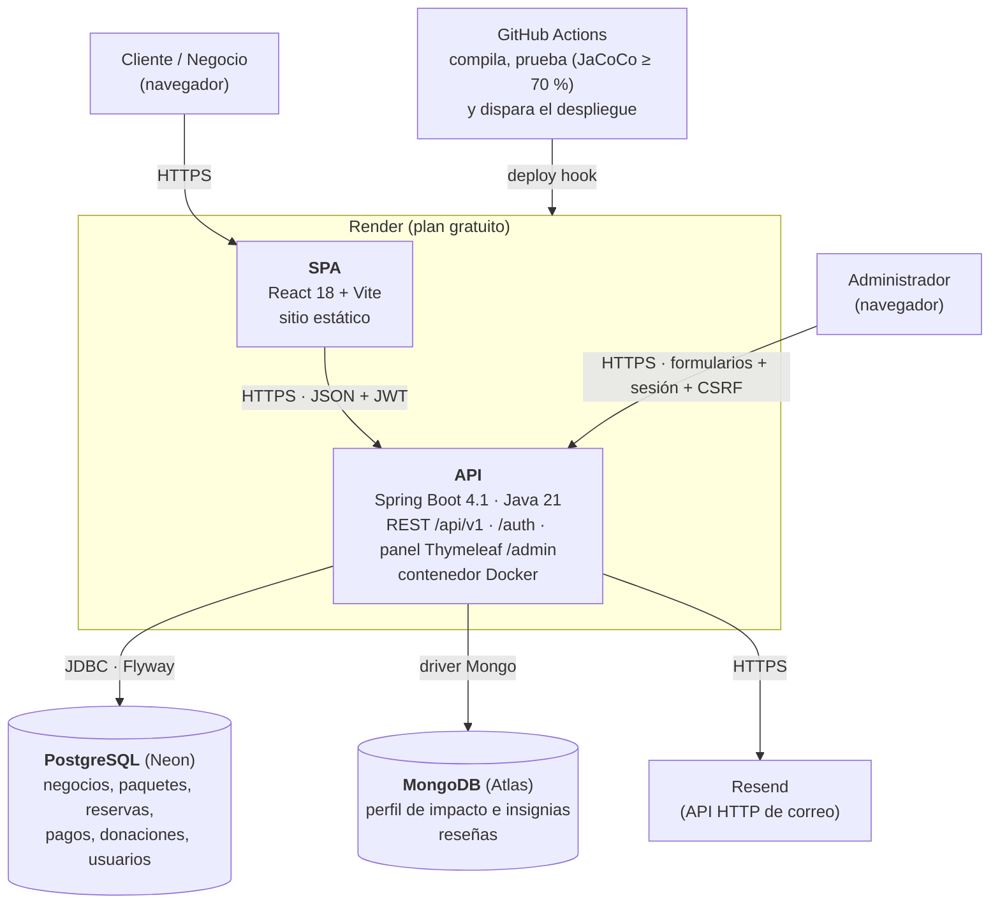
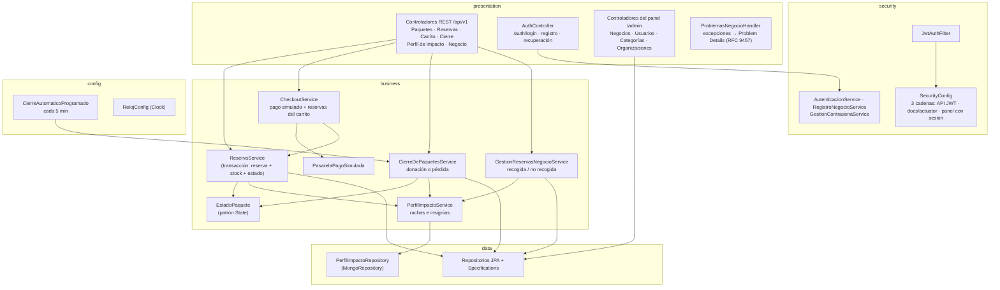

# Documento de arquitectura — Savora

EIF509 Desarrollo de Aplicaciones Basadas en Web · II Ciclo 2026
Yeilin Moya Baltodano y Nazareth Gómez Gómez

Sistema publicado: API <https://savora-api-ff0z.onrender.com> · SPA <https://savora-spa.onrender.com> ·
Swagger <https://savora-api-ff0z.onrender.com/swagger-ui.html> · Panel administrativo
<https://savora-api-ff0z.onrender.com/login>

## Contenido

1. [Contexto del sistema (C4, nivel 1)](#1-contexto-del-sistema-c4-nivel-1)
2. [Contenedores (C4, nivel 2)](#2-contenedores-c4-nivel-2)
3. [Componentes de la API (C4, nivel 3)](#3-componentes-de-la-api-c4-nivel-3)
4. [Decisiones de arquitectura (ADR)](#4-decisiones-de-arquitectura-adr)
5. [Modelo de datos](#5-modelo-de-datos)
6. [Seguridad](#6-seguridad)
7. [Procesos de negocio y su transaccionalidad](#7-procesos-de-negocio-y-su-transaccionalidad)
8. [Lecciones aprendidas](#8-lecciones-aprendidas)

## 1. Contexto del sistema (C4, nivel 1)

Savora conecta negocios de comida con clientes que compran su excedente a precio reducido y, cuando un paquete
no se vende, con organizaciones comunitarias que lo reciben como donación.

La pasarela de pagos real queda **fuera del alcance** (decisión del ADR-002): el pago es una simulación dentro
de la propia API.

## 2. Contenedores (C4, nivel 2)

| Contenedor | Tecnología | Responsabilidad |
|---|---|---|
| SPA | React 18, Vite, react-router (HashRouter) | Catálogo, carrito, pago simulado, reservas, impacto e insignias; vistas de cliente y de negocio |
| API | Spring Boot 4.1, Java 21, Gradle | Reglas de negocio, seguridad, persistencia, panel administrativo y tareas programadas |
| PostgreSQL | Neon, migraciones Flyway | Datos transaccionales y maestros |
| MongoDB | Atlas | Datos documentales: perfil de impacto y reseñas |
| Pipeline | GitHub Actions | Compilar, probar, verificar cobertura y desplegar solo desde `main` |

## 3. Componentes de la API (C4, nivel 3)

La API se organiza en cuatro capas con dependencias en un solo sentido:
`presentation → business → data`, y `config`/`security` como transversales.

## 4. Decisiones de arquitectura (ADR)

| ADR | Decisión |
|---|---|
| [ADR-001](adr/ADR-001-version-spring-boot.md) | Versión de Spring Boot |
| [ADR-002](adr/ADR-002-dominio-y-alcance.md) | El dominio y su alcance |
| [ADR-003](adr/ADR-003-sql-nosql.md) | SQL o NoSQL para cada subdominio |
| [ADR-004](adr/ADR-004-patrones-de-diseno.md) | Patrones de diseño aplicados |
| [ADR-005](adr/ADR-005-autenticacion.md) | Estrategia de autenticación |
| [ADR-006](adr/ADR-006-plataforma-y-despliegue.md) | Plataforma y estrategia de despliegue |

## 5. Modelo de datos

- Modelo completo, criterios y diagramas: [`modelo-datos-lab2.md`](modelo-datos-lab2.md).
- Decisión SQL/NoSQL: [ADR-003](adr/ADR-003-sql-nosql.md).
- Migraciones Flyway `V1` a `V10` en `src/main/resources/db/migration`.

Resumen: PostgreSQL guarda negocios, categorías, clientes, organizaciones, paquetes, reservas, donaciones,
usuarios y pagos. MongoDB guarda `PerfilImpacto` (contadores, racha semanal e insignias incrustadas) y
`Resena`. El vínculo entre ambos mundos es por id, sin llave foránea real.

## 6. Seguridad

- Auditoría con la lista de verificación de la Sesión 14 y el OWASP Top 10:2025: [`../AUDITORIA-SEGURIDAD.md`](../AUDITORIA-SEGURIDAD.md).
- Modelo de roles y JWT: [`seguridad-lab5.md`](seguridad-lab5.md) y [ADR-005](adr/ADR-005-autenticacion.md).
- Secretos solo por variables de entorno; perfiles `dev`, `test` y `prod`; despliegue: [`despliegue-lab6.md`](despliegue-lab6.md).

## 7. Procesos de negocio y su transaccionalidad

| Proceso | Dónde vive | Garantía |
|---|---|---|
| Reservar (y pagar el carrito) | `ReservaService`, `CheckoutService` | Una transacción en PostgreSQL: se autoriza el pago, se crean las reservas, se descuenta el stock y se guarda el pago. Si algo falla, no se reserva ni se cobra nada. |
| Cierre de paquetes no vendidos | `CierreDePaquetesService` + tarea programada | Cada paquete se cierra en su operación; uno con problemas no frena a los demás. |
| Historial de impacto | `PerfilImpactoService` (MongoDB) | No participa en las transacciones de PostgreSQL. Es consistencia eventual aceptada. |

Concurrencia: `PaqueteSorpresa` usa `@Version` (bloqueo optimista). Dos clientes que reservan el mismo
paquete a la vez provocan un conflicto que la API responde con 409. La prueba `PaqueteSorpresaOptimisticLockIT`
lo demuestra.

## 8. Lecciones aprendidas

1. **Inyectar el reloj.** Usar un `Clock` en vez de `now()` permitió probar la hora límite, el cierre y las
   rachas semanales con fechas fijas. Sin eso, esas pruebas serían frágiles.
2. **Datos semilla con fechas relativas.** Los paquetes de la semilla original tenían la hora límite vencida y
   la reserva no se podía demostrar sin crear datos a mano. Una semilla de desarrollo debe calcular sus fechas
   respecto a `now()`.
3. **Mongo no entra en la transacción de PostgreSQL.** Si el commit falla después de actualizar el perfil de
   impacto, el contador queda adelantado. Lo aceptamos porque el perfil es informativo y no afecta el dinero ni
   el stock, pero hay que saberlo y decirlo.
4. **Autenticar en la capa correcta.** El `clienteId` y el `negocioId` se toman del token y nunca del cuerpo de
   la petición. Eso evita el acceso a recursos ajenos (IDOR) por diseño, no por validaciones sueltas.
5. **CSRF y `accessDeniedPage`.** Una página de acceso denegado igual a la de login reenviaba la petición y
   dejaba pasar un `POST /login` sin token. Un manejador que redirige y una prueba que exige 403 lo resuelven.
6. **Una restricción de base de datos también es una regla de negocio.** `uq_reserva_paquete` (una reserva por
   paquete) simplifica el control de concurrencia, pero limita cada paquete a una sola venta aunque la cantidad
   sea mayor. Es una decisión consciente y conviene documentarla.
7. **Render agrega un sufijo a los nombres tomados.** La API quedó en `savora-api-ff0z`, no en `savora-api`.
   Hay que anotar las URLs reales en el README y en los diagramas apenas existen.
8. **Pagos simulados, pero con disciplina real.** Aunque no se cobra nada, nunca se guarda el número completo
   de la tarjeta ni el CVV: solo la marca, los últimos cuatro dígitos y una referencia.
9. **Desplegar desde la integración continua.** Con `autoDeploy: false` en Render y un deploy hook en GitHub
   Actions, solo llega a producción lo que pasó compilación, pruebas y cobertura en `main`.
10. **Trabajar por bloques con verificación.** Cada bloque (administración, pago, carrito, rachas) se probó y se
    integró a `main` antes de empezar el siguiente. Cuando se acumularon cambios sin probar fue cuando
    aparecieron los errores.