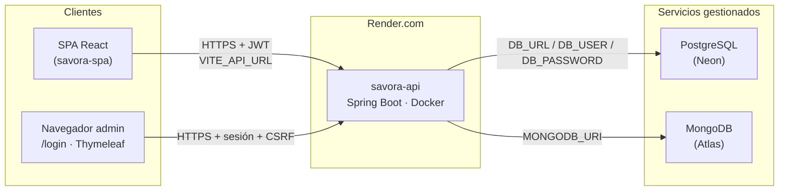

# Diagrama de despliegue — Laboratorio 6

Complete las URLs reales de su entrega en Render antes de subir al aula virtual.

## Variables de entorno (solo nombres)

| Servicio | Variable | Uso |
|---|---|---|
| savora-api | `SPRING_PROFILES_ACTIVE` | Perfil `prod` |
| savora-api | `SAVORA_JWT_SECRET` | Firma JWT (generado en Render) |
| savora-api | `DB_URL`, `DB_USER`, `DB_PASSWORD` | PostgreSQL (Neon) |
| savora-api | `MONGODB_URI` | MongoDB Atlas |
| savora-api | `SAVORA_CORS_ORIGINS` | Origen HTTPS de la SPA (sin `/` final) |
| savora-api | `SAVORA_SEED_NEGOCIO_PASSWORD` | Contraseña de `negocio1` / `negocio2` |
| savora-api | `SAVORA_SEED_CLIENTE_PASSWORD` | Contraseña de `cliente1` (SPA) |
| savora-spa | `VITE_API_URL` | URL pública de la API (sin `/` final) |

Guía paso a paso: [despliegue-lab6.md](despliegue-lab6.md).
