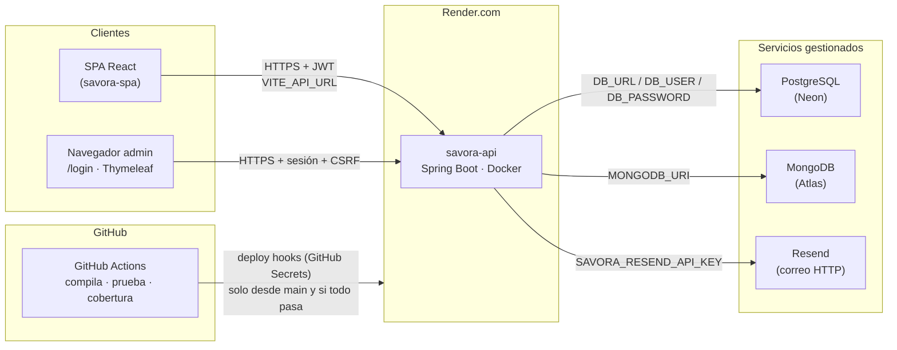

# Diagrama de despliegue — Laboratorio 6

## Sistema publicado

| Qué | Dirección |
|---|---|
| API | <https://savora-api-ff0z.onrender.com> |
| SPA | <https://savora-spa.onrender.com> |
| Swagger UI | <https://savora-api-ff0z.onrender.com/swagger-ui.html> |
| Panel administrativo | <https://savora-api-ff0z.onrender.com/login> |

El nombre del servicio de la API lleva el sufijo `-ff0z` porque Render lo agrega cuando el nombre ya está tomado.

## Variables de entorno (solo nombres)

| Servicio | Variable | Uso |
|---|---|---|
| savora-api | `SPRING_PROFILES_ACTIVE` | Perfil `prod` |
| savora-api | `SAVORA_JWT_SECRET` | Firma JWT (generado en Render) |
| savora-api | `DB_URL`, `DB_USER`, `DB_PASSWORD` | PostgreSQL (Neon) |
| savora-api | `MONGODB_URI` | MongoDB Atlas |
| savora-api | `SAVORA_CORS_ORIGINS` | Origen HTTPS de la SPA (sin `/` final) |
| savora-api | `SAVORA_SEED_NEGOCIO_PASSWORD` | Contraseña de `negocio1` / `negocio2` |
| savora-api | `SAVORA_SEED_CLIENTE_PASSWORD` | Contraseña de `cliente1` (SPA) |
| savora-api | `SAVORA_SEED_ADMIN_PASSWORD` | Contraseña del usuario `admin` (panel) |
| savora-api | `SAVORA_SPA_URL` | URL de la SPA para los enlaces de los correos |
| savora-api | `SAVORA_RESEND_API_KEY`, `SAVORA_MAIL_FROM` | Correo de recuperación de contraseña (opcional) |
| GitHub Secrets | `RENDER_DEPLOY_HOOK_API`, `RENDER_DEPLOY_HOOK_SPA` | Hooks de despliegue, solo en el pipeline |
| savora-spa | `VITE_API_URL` | URL pública de la API (sin `/` final) |

Guía paso a paso: [despliegue-lab6.md](despliegue-lab6.md).